TEMPORARY README
# Objective

## Goal
build a fast AES-256 Core, made to encrypt/decrypt high volumes of data, up to hundreds of MB/s,  with parallelism, using GCM to ensure integrity and authenticity (on top of confidentiality).

clock : 100MHz 
block size : 16 bytes
thoughput : 2 blocks/cycle
-->3,2 GB/s

We will therefore try to reach these objectives, within our FPGA ressources.
### plan 
- overview of the AES algorithm and GHASH algorithm 
- estimate some architectral choices's costs and decide which one we take for a first implementation (optimization for the sake of elegance will come later)
- implement the whole module

### Guidelines : 
Latency has no importance
The only metrics that are really interesting are **thoughput**, and **ressources consumption**.

### overview
This is a provisionnal overview of how the system should look like :

[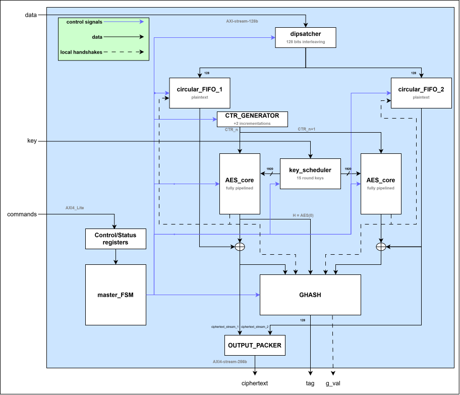](assets/general_target_architecture.drawio.svg)

*Click the image to open the full-resolution SVG.*

The system should : 
- take an input thought a streamin AXI interface
- dispatch it on 2 different columns
	- each clock cycle, we aim to receive 2 full 128b blocks of data maximum (we will have two clock domains)
- process those data through 2 AES engines
- produce the authentification tag through the GHASH engine
- produce ciphertext sent by a streaming output
## target info
Target device: Xilinx XC7A100TCSG324-1

Board reference: Arty A7-100
Blocks Rams : 270 x 18Kb / 135 x 36 Kb

DSP48E1 Slices : 240

Logic Cells : 101 440

Slices : 15 850

Max distributed RAM : 1 188 Kb 

100MHz clock (cristal oscillator on the board),

do not plan to use Clock management Tiles to reach higher frequencies --> stick to 100MHz
# AES engine
## ciphering operations 
AES has a fixed block size of 128 bits / 16 bytes

key lenght can vary : 128, 192, 256 bits

Number of rounds differs depending on the key size :
- 10 rounds for 128-bit keys
- 12 rounds for 192-bit keys
- 14 rounds for 256-bit keys

AES blocks are organized as bytes noted b0, b1... b15

b0 = MSB

b15 = LSB

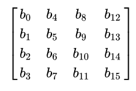

Or we can name bytes above as matrix coordinates a(i,j) (i = row, j = column)

**Basic operations (common to all AES sizes)  :**
- AddRoundKey : state + round_key[^1]
- SubBytes :b(i,j) = s( a(i,j) )
- ShiftRows : b(i,j) = a(i, (j+i)mod4 )
- MixColumns : for each columns of the state a : 
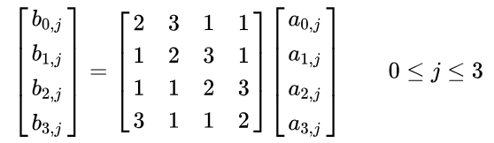

[^1]: An Addition in GF(2^8) is a XOR

**Key Expansion Scheme :** 

uses the original key to generate round keys[^2]

[^2]: each round of AES uses a different "sub-key" : we call it "round key" (128 bits)

The round constant rcon(i) for round i of the key expansion is the 32-bit word : 

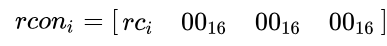

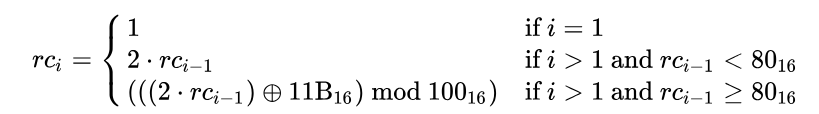

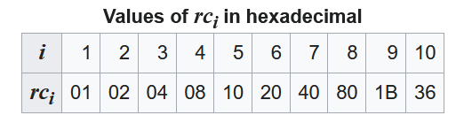

We define:
- N = number of 32 bits words in original key, named K0... KN-1 (K0 = LSB)
- R as the number of round keys needed: 11 round keys for AES-128, 13 keys for AES-192, and 15 keys for AES-256
- W(0), W(1), ... W(4R-1) as the 32-bit words of the expanded key

RotWord = one-byte left circular shift

RotWord ⁡( (b0, b1, b2, b3) )= (b1, b2, b3, b0)

SubWord = Sbox each byte of a 4 byte word :

SubWord ⁡( (b0, b1, b2, b3) )= (S(b1), S(b2), S(b3), S(b0)) 

Then for i = 0 … 4R−1 :

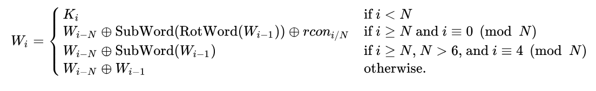
## AES algorithm
1. initial AddRoundKey with the round_key
2. 9, 11 or 13 rounds of : 
	- SubBytes
	- ShiftRows
	- MixColumns
	- AddRoundKey
3. Final round of : 
	- SubBytes
	- ShiftRows
	- AddRoundKey
## deciphering
Very convenient : no need for inverse operations of AES for GCM mode : decrypting uses only forward AES operations ! 
## optimisations
There are optimizations to put together mixrows, mixcolumns, and subbytes in a single operation.
It consumes 4kB of memory to be able to perform this operation in 16 look ups on a LUT / memory.

Ciphering and deciphering logic can be :
- unrolled --> biggest throughput 
- rolled = smallest form factor

Highest througput could also be achieved by putting multiple AES cores
GCM parallelism should be explored.

## quick dimensions

Available : 
- 63400 slice LUTs
- 128800 slice registers
- 31799 F7 Mux
- 270 / 135 RAM 18Kb / 36 Kb

| module                         |         BRAM blocks         |                                                                           ~LUTS | cycles to complete                  | comments                             |
| ------------------------------ | :-------------------------: | ------------------------------------------------------------------------------: | ----------------------------------- | ------------------------------------ |
| MixColumns  (over 1 column) |              /              |                                                                         32 LUTs | asynchronous                        | 1 column requires ~8 "32-bits-xors"  |
| AddRoundKey                    |              /              |                                                                       ~128 LUTs | asynchronous                        |                                      |
| ShiftRows                      |              /              |                                                                               0 | asynchronous                        |                                      |
| SubBytes                       | 8/4/2/1 True dual port 18Kb |                 0/34 LUTs 128/145 FF 0/16 F7 8 BRAM Case / 1 BRAM case | 1/2/4/8 (8 RAM 18 = 4 RAM Tiles) | 2Kb per BRAM                         |
| TOTAL ESTIMATED                | 8/2/4/1 True dual port 18Kb |                                              ~300 LUTs 145 FF 16 F7 Muxes | 1/2/4/8 / round                     | no module have been plugged together |
| OR                             |                             |                                                                                 |                                     |                                      |
| T-table over whole state       | 8/4/2/1 True dual port 36Kb | 129/73 LUTs  129/177 FF 0/16 F7 Muxes   8BRAM case / 1 BRAM Case | 1/2/4/8 / round                     | 8 XORS 32 bits                       |
|                                |                             |                                                                                 |                                     |                                      |
| KEY SCHEDULER                  |                             |                                                              208 LUTS 134 FF | 15                                  |                                      |
|                                |                             |                                                                                 |                                     |                                      |

### Choices 
- we won't use T-table optimization :
	- no matter the way we turn it, by duplicating AES engines or unrolling round logics, it requires ~116 BRAMS to achieve a thoughout of 16 bytes/cycle 
	- One full AES ciphering logic circuit requires 8\*14 = 112 BRAMs 36Kb (and we have only 135 of those) : we can therefore make only 1 AES engine
	- Using sboxes requires 8\*15 = 120 BRAMs 18Kb, we have 270 BRAMS 18Kb, --> we can implement 2 AES engines --> up to twice the thoughput
	  (as long as the Ttables-AES-engine isn't twice as efficient as sbox-AES-engine, we gain thoughput : we do not expect T_tableèAES-engine implementation to meet a frequency 2 times higher than sbox-AES_engine)
- We will use 8 BRAMS for sub-bytes : 
	- for the sake of simplicity : an AES round can therefore take 1 clock cycle instead of more clock cycles, easing the unrolling of the logic
	- therefore, we will end up with 2 AES cores unrolled, which is easier to manage when we feed data onto them
	- the 1BRAM choice would have divided by 8 the thoughput, making us having to multiply by 8 the number of AES core to catch up, and add extra logic to feed data into these cores
- We prefer to have a minimum of AES engines
- Key scheduler will not implement the RCON calculation logic : it costs only a few tdozens of registers to store the usefull RCon(i) values \[01, 02, 04, 08, 10, 20, 40, 80\]

**Final choice for AES core :** 
- subbytes implemented using 8 BRAMs
- completely unrolled rounds
-  --> 2 AES cores
	- 2 blocks/cycles thoughput, with  ~15 cycles of latency
	- easy to manage, to feed with data, to distribute round keys
The full AES core (key scheduler not included) should therefore weight around :
- 300 LUTS x 14 ~ 5k LUTS
- 16 F7 Muxes x 14 ~ 250 F7 muxes
- 145 FFs x 14 ~ 2k FFs
## implementation

# GHASH engine

## GHASH operations 
The GHASH part (that is used to calculate the authentification tag) is based on **multH** operation on GF(2^128) field defined by the polynom P

P := 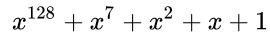

### multiplication (multH) in GF(2^128)
**MultH** is a 128b x 128b carry-less product, followed by a modulair reduction (i.e bring it back to 128b, using modulo P)

H is a constant, calculated by ciphering 0 with the key K :

H := AES(0, key)

Multiplication, over 1 bit, use the **same xtime operation as in AES encryption** : shift left, followed by a XOR with a different polynom P if the 128-th bit is 1 (modular reduction).

Hence, as a first implementation, we can just stack a few of xtimes between 2 rows of registers to process multiple bits per clock cycles, the only metrics influenced by it is FMax, that just has to stay above 100MHz (the board's clock)

### quick dimensions

| number of bits calculated per step | LUTS | FF reg |     FMAX |     | number of partial multH needed | Total LUTS | Total FFs |
| ---------------------------------- | :--: | ------ | -------: | --- | ------------------------------ | ---------- | --------- |
| 4                                  | 269  | 128    | ~500MHz+ |     | 64                             | 17k        | 8192      |
| 8                                  | 549  | 128    | ~400MHz+ |     | 32                             | 17k        | 4096      |
| 16                                 | 1147 | 128    |  ~400MHz |     | 16                             | 18k        | 2048      |
| 32                                 | 2467 | 128    |  ~350MHz |     | 8                              | 20k        | 1024      |

Those numbers are very high because they are on an isolated testbench : logic itself takes around 30% of the time only in those values, the rest is routing delay

#### choice 
Even the 32 way multH is extremely confortable to hold the 100MHz constraint, therefore we opt for this choice, that reduces latency, and simplifies GHASH block, especially for tailing.
It also allows a huge economy of FFs for a minor cost in additionnal LUTS

## GHASH algorithm

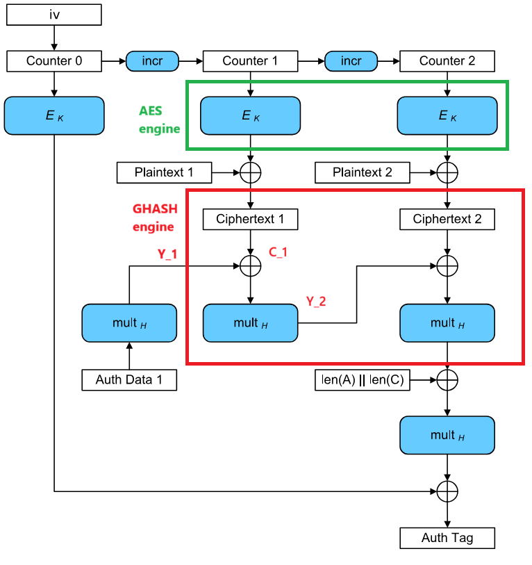

**caption :** 

Ek = AES(input, key)

multH = input x H

Ciphertext is fed into the G_HASH engine, that basically takes previous tag Y(i-1), xor it with a ciphertext block, and multiply it by H. Only the first and last operations differs.

### break dependency on previous tag
The basic equation to propagate the tag calculation is : Yi = ( Y(i-1) + C(i-1) ) x H
To advance one step ahead, we need the previous tag calculated, but a 128x128 bits carry-less multiplication isn't achievable in one clock cycle(or it will affect max frequency dramatically) (+ we have to digest at maximum 2 x 128bits blocks per cycle)

We parallelize it by killing the dependency to each Y(i)
By simply developing, we can write a formula where we need only the Y_(i-M) from M steps before : 
Y_(i) = ( C(i-M) + Y(i-M) ) x H\^M 

\+ C(i-M+1) x H\^(M-1) 

\+ ... 

\+ C(i) x H

("^" means "power" here | "+" means "XOR") 

Therefore, we can pipeline the GHASH algorithm to be able to digest 2 blocks/cycle, while letting the time for the GHASH to calculate the Y_(i) we need for the next **batch[^3]**.

[^3]:We will call **batch** a sequence of M blocks that depends on only one Y_i tag to calculate the next tag

For our choice (multH_32), the equation becomes : 

Y(i) = ( C(i-7) + Y(i-7) ) x H\^8[^4]

\+ C(i-6) x H\^7

\+ C(i-5) x H\^6

\+ C(i-4) x H\^5

\+ C(i-3) x H\^4

\+ C(i-2) x H\^3

\+ C(i-1) x H\^2

\+ C(i) x H

Here, we use C(i), but we begin with all AAD (Authentified data) blocks, and then with ciphertext

[^4]:C(i-7) is associated with Y(i-7) (the previous tag) : we will call it the "**end-of-batch block**"
### algorithm sequence

Goal : digest 2 AES blocks / clock cycle maximum
Mechanism : 
- initialization : H and powers of H (up to 8) needed
- AES digests blocks by pairs (2 blocks) which are waiting on a FIFO : 
	- It waits for 2 blocks to be on FIFO: and when it is the case, it sets :
		- valid = '11' : 2 blocks are being used
		- else valid = '00' : when FIFO is empty
	- only exception is the last block if it isn't paired 
		- valid = '10' or '01'
- AAD blocks, and then AES output blocks, are digested by GHASH

GHASH is supposed to digest a pair of block in 4 cycles
--> We pack blocks in 2\*4 blocks : we called it a **batch[^3]** of 8 blocks

### architecture overview
More details can be found in [ghash details](doc/GHASH_details.md) to fully understand the operations sequence
here, we just explain general parts of this module and their role.

[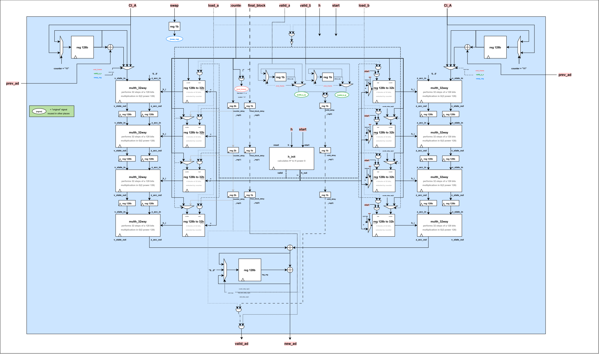](assets/G_HASH.drawio.svg)

*Click the image to open the full-resolution SVG.*

#### parts of GHASH
[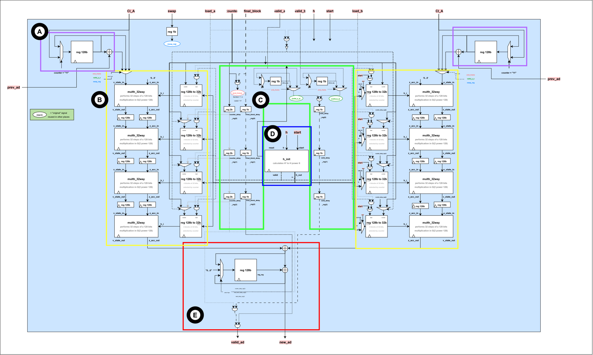](assets/G_HASH_overview.drawio.svg)

*Click the image to open the full-resolution SVG.*
##### A (Purple) : end of batch register
A batch is a sequence of 8 blocks used to calculate the next "intermediate tag" (new_ad output below) depending on only one previous tag (prev_ad input in right hand and left hand parts of the module).
as we have seen in our equation (see " dependency on previous tag"), the "end of batch" is the ciphertext associated with previous tag to calculate the next tag

Since the GHASH module has latency (it takes 4 clock cycles for a ciphertext to influence the output), the end-of-batch ciphertext has to be stored while the previous tag is being calculated.

For more details, again, check docs/GHASH.md

##### B (Yellow) : processing columns
Two columns (column A and column B, associated with their input signals like valid_a/valid_b, load_a and load_b)

A batch is composed of 8 ciphertexts C0, ..., C7

C0, C2, C4 and C6 are issued from AES engine A

C1, C3, C5 and C7 are issued from AES engine B

each of them produce ciphertexts at the same time (with valid_a and valid_b handshake signals, that are supposed to always be at 0 or 1 together, with one exception for tailing when message lenght is odd (in terms of number of 128 bits blocks)

Each columns are organised into 4 rows

Those columns are composed of : 
- 4 multH_32 interleaved with registers--> to process a 128 bits multiplication in 4 cycles
- 4 "powerH banks" : they are 128 bits registers that contains each of them a part of a power of H
	- the first one contains bits \[31:0] of H², H power 4, H power 7 and H power 8 in column A
	- the second one contains bits \[64:32\] of H², H power 4, H power 7 and H power 8 in column A, etc...

##### C (green) : internal handshake signals
mainly displays counter delay registers (to propagate the counter to each row of the processing columns (B : yellow)) and valid delay registers so "valid" bits follow their respective blocks to each rows of the processing columns.

--> when a block has been completely processed throught the 4 rows, it arrives to the result block (E : red) with its valid signal and counter signal

##### D (blue) : H powers initializator
Contains the H_init block, responsible to calculate the powers of H (H² to H power 8) when the start signal is triggered.

It gives in output one power of H each 4 cycles, with a "valid" handshake signal, so it can be saved in "H power banks" in processing columns, depending one load_a and load_b signals which decides which columsn has to register a certain power of H (odd powers of H go in column B, even powers of H go in column A)

##### E (red) result block
part receiving the outputs of the processing columns (B : yellow), that can mix together new partial calculations of the next tag, and resets to 0 when a tag has been successfully calculated, to begin to calculate the next one.

##### to sum it up
GHASH engine is first initialized in D : blue :
- reveives H, and a start signal
- calculates powers of H to store those powers in registers in the processing columns (B : yellow)

Then data from AES engines are processed through the 4 rows of the processing columns (B : yellow) and arrives at the result block (E : red) to be mixed with the others cipherblocks of the same batch (8 cipherblocks)

The end of batch register (A : purple) is here just to match the different timing at which the previous tag is available to calculate the new one

and the internal control signals (C : green) are here to manage all of this, and propagate control signals at the same rate the cipherblocks are processed throught the 4 rows of processing columns

## implementation
latency = 4 cycles

thoughput : 2 blocks/cycle

stream size = 4\*2 = 8

LUTs : 20k

target frequency : 500MHz (2ns period) |  WNS = -5,37ns | FMAX ~136 MHz

target frequency : 100MHz (10ns period) |  WNS = 1,07ns | FMAX ~112 MHz

**TIMING MET for GHASH block**

# credits 
credits to wikipedia's article on AES GCM and ["Announcing the ADVANCED ENCRYPTION STANDARD (AES)"](https://nvlpubs.nist.gov/nistpubs/FIPS/NIST.FIPS.197-upd1.pdf)(PDF). _Federal Information Processing Standards Publication 197_. United States National Institute of Standards and Technology (NIST). November 26, 2001. [Archived](https://web.archive.org/web/20240823165748/https://nvlpubs.nist.gov/nistpubs/FIPS/NIST.FIPS.197-upd1.pdf) (PDF) from the original on August 23, 2024. Retrieved August 26, 2024.