This part aims to explain the mechanisms of GHASH engine, used to calculate the authentification tag of a message.

# break dependency
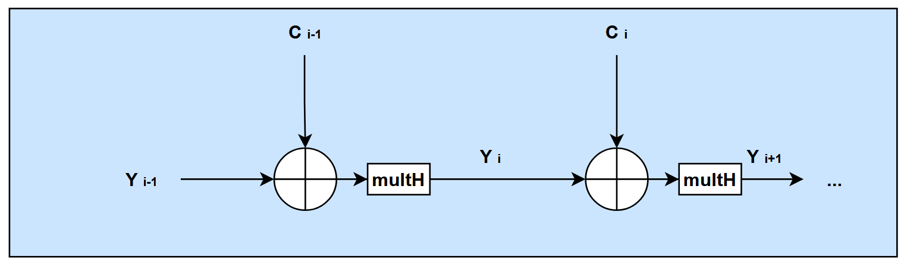

This is how operations should occur ideally : 
- a cipherblock arrives and is XORED with previous tag Y(i-1)
- the result is multiplied by H --> we obtain Y(i)
- do it again until you consummed all authentificated input data and all cipherblocks

**Problem** :  implementing the 128 steps of multH would ruin frequency

--> we break multH in 4 cycles (cf main README : GHASH engine/GHASH operations/quick dimensions)

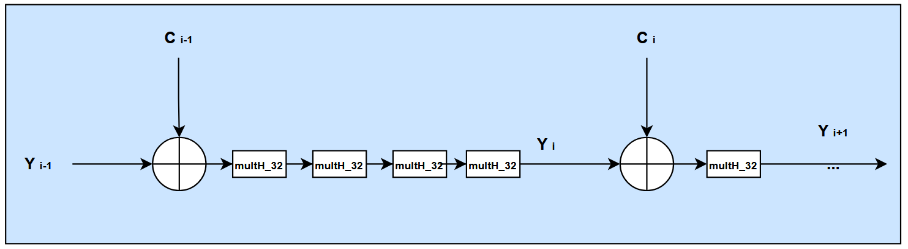

Now, there is **4 cycles of latency*** between Y i-1 and Y i :
- We are able to process only 1 block of data (C(n)) each 4 cycles (because we need Y(i) to calculate Y(i+1), and so on...)
- We want to process 2 blocks/cycle

--> parallelize : if we want to multiply our actual thoughput by 8, we have to break the dependency of Y(i) on Y(i-1) which takes 4 cycles to be processed.

(A) : Y(i) = ( C(i-1) + Y(i-1) ) x H

(B) : Y(i-1) = ( C(i-2) + Y(i-2) ) x H

In (A), we replace Y(i-1) by (B) :

(C) : Y(i) = ( C(i-1) +( ( C(i-2) + Y(i-2) ) x H ) ) x H

= C(i-1) x H + ( C(i-2)xH + Y(i-2)xH ) x H

Y(i) = ( C(i-2) + Y(i-2) )xH² + C(i-1)xH

Here, Y(i) depends on Y(i-2).

We can extand this principle to obtain the relation that will enable us to process 2 blocks each clock cycles, that is possible with 4 cycles of delay between each Y(i) :

Y(i) = ( C(i-8) + Y(i-8) ) x H\^8

\+ C(i-7) x H\^7

\+ C(i-6) x H\^6

\+ C(i-5) x H\^5

\+ C(i-4) x H\^4

\+ C(i-3) x H\^3

\+ C(i-2) x H\^2

\+ C(i-1) x H

- at clock cycle 0, we process C(i-8) and C(i-7), with Y(i-8) available, since C(i-8) needs it
- at clock cycle 1, we process C(i-6) and C(i-5)
- at clock cycle 2, we process C(i-4) and C(i-3)
- at clock cycle 3, we process C(i-2) and C(i-1)
- at clock cycle 0 (loop back), Y(i) should be available, we can process C(i) and C(i+1) with Y(i) avialable
- and so on...

We need therefore **8 powers of H**, we will see this in the [dedicated section](#h-powers-calculation-and-organization).

# organisation of the G_HASH block and data input

Imagine a max throughput input of 2 blocks/cycle. We organize ourselves in 2 columns : 
- one for the data input needing the "even" powers of H to be processed : C0, C2, C4, C8...
- one for the data input needing the "odd" powers of H to be processed: C1, C3, C5, C7...

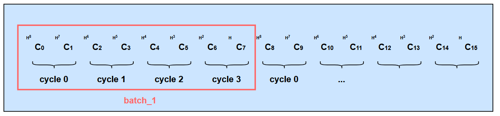

We ALWAYS process blocks by pairs (except for special cases at the end of this document).

Batch_1 means the 8 blocks C0 to C7 depends on one "previous tag" Y0" to calculate Y8. Y8 will be available 4 clock cycles after the last blocks of the batch has been admitted in input.

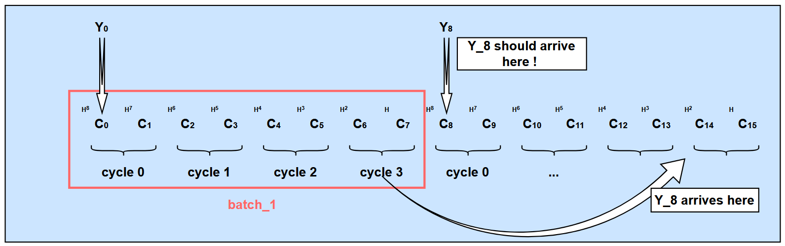

As we can see, organizing blocks naïvely makes Y8 arriving too late.

C8 and C9, which needs Y8 to be processed, can be kept while Y8 is coming. (only C8 needs Y8, but we keep C9 too, because we process blocks by pairs, it will be usefull for some special cases described in the [special cases section](#special-cases-:-the-uncomplete-final-batch), where sometimes, its an "odd" block that needs the previous tag).

This leads us to this new organization, which is the final form ; 

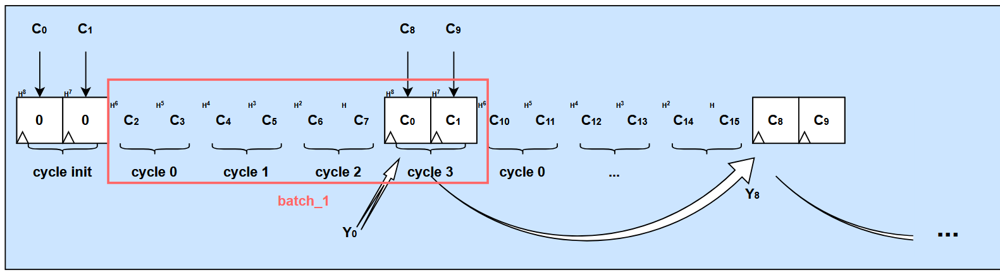

We now have the right timing and the right organisation.

We will call the pair of blocks needing previous tag Y (here, C0|C1, and C8|C9 for example) **end-of-frame blocks**, or sometimes **end-of-batch**  : these ones are the ones that can be stored on registers.

we initially load the end-of-batch blocks on registers, and we free them at the end.

This is what you can see below in the architecture diagram : 

On the left hand side, the processing column A is processing input blocks Ci_a needing even powers of H, with the register in the top left corner saving end-of-frame blocks.

This is the same on the right side, for odd powers of H.

There are, on each columns, 4 rows of multH_32, with registers between them, hence the 4 cycles delay between a block being accepted in input, and the production of an effect that can be registered.

[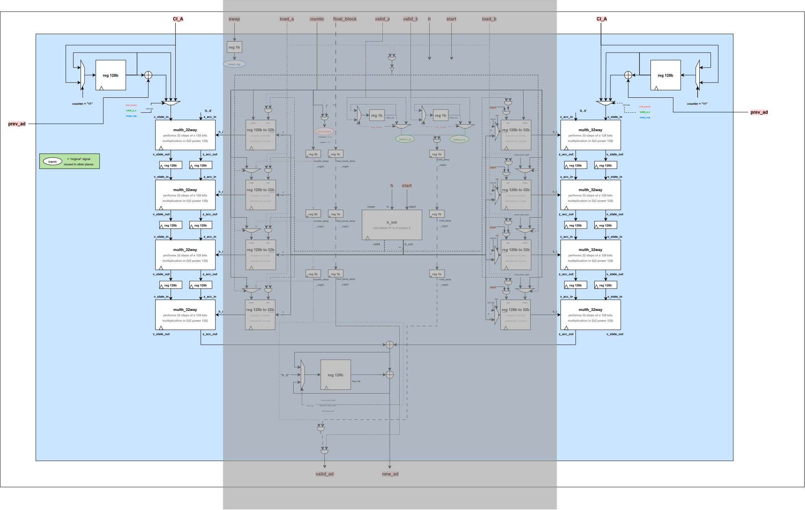](assets_GHASH/G_HASH_processing_columns.drawio.svg)

*Click the image to open the full-resolution SVG.*
## data output 

Suppose we put in input C0 to C7, as earlier.
The operation to calculate Y8 is : 

Y(8) = ( C(0) + Y(0) ) x H\^8

\+ C(1) x H\^7

\+ C(2) x H\^6

\+ C(3) x H\^5

\+ C(4) x H\^4

\+ C(5) x H\^3

\+ C(6) x H\^2

\+ C(7) x H

- At cycle 0, C0 and C1 are registered
- At cycle 1 to 3, C2 to C7 are accepted in the processing columns
	- And at cycle 3, C2|C3 arrive in the bottom to be XORED and stored on an accumulation register called "tag register" :
	- This is the C2xH\^6 + C(3)xH\^5 result that is stored here in first
- At cycle 4, C0 and C1 are accepted in the processing columns
	- And C4|C5 arrive in the bottom to be XORED ans stored :
	- This is the C4xH\^4 + C(5)xH\^3 that is accumulated on the top of the previous C2xH\^6 + C(3)xH\^5 result... 
- and so on...

[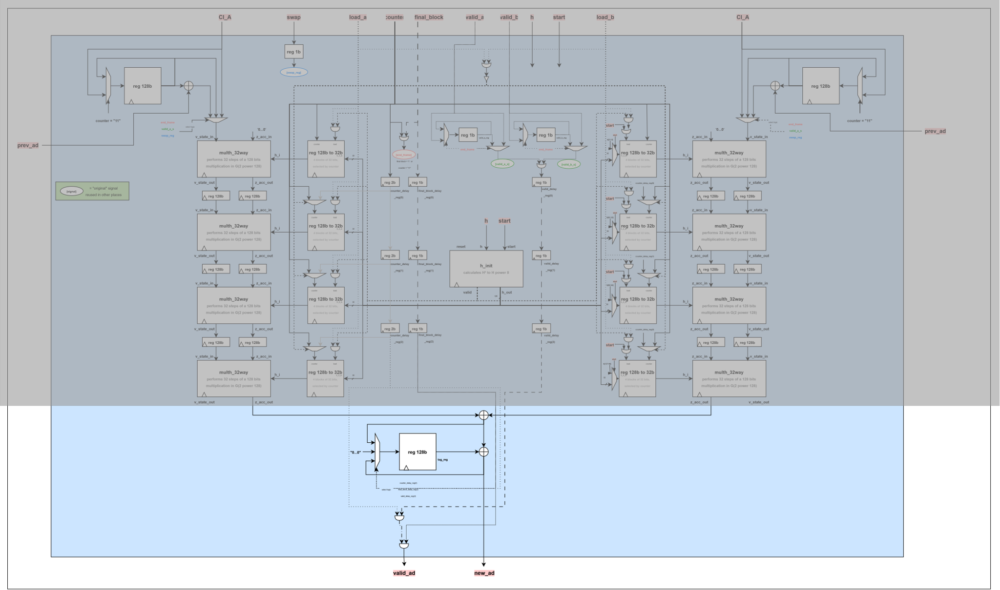](assets_GHASH/G_HASH_result_accumulation.drawio.svg)

*Click the image to open the full-resolution SVG.*

To sum it up, this bottom part of the schematic is the accumulator :
- processing columns (on left and right side of previous schematic) take C(i) and C(i+1)
	- they calculate C(i) x H power (X) and C(i+1) x H power (X-1) (X = 2, 4, 6 or 8)
- result accumulator in the bottom part, adds up the two results of processing columns
	- C(i) x H power (X) **+** C(i+1) x H power (X-1)
- the accumulator is flushed back to 0 when it reaches an end-of-batch pair of blocks (it knows it when a valid signal, along with a counter = 3, arrives, we will see it later)

## H powers calculation and organization

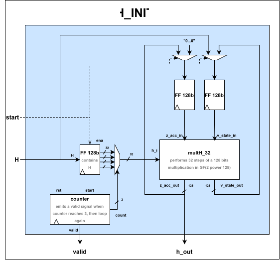

This module :
- calculates the next power of current H each 4 clock cycles --> H is now stored in the FF 128b above the counter.
	- when a power of H is ready (H², H\^3, etc...), valid output signal is triggered
Therefore, this module, once started, takes 28 cycles to create H² to H\^8.

It reuses the same multH_32 to limite costs, since a multH_32 is already heavy, and we do not need a low latency on H powers initialization.

Let's zoom out : 

[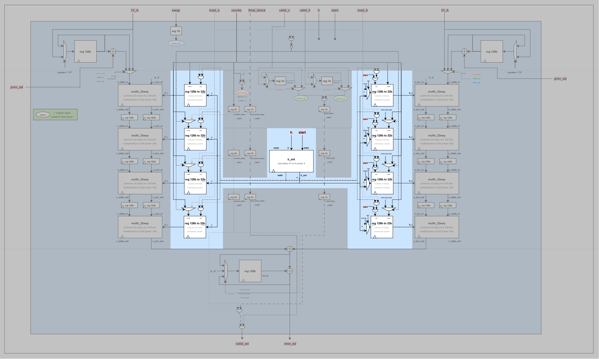](assets_GHASH/G_HASH_H_powers.drawio.svg)

*Click the image to open the full-resolution SVG.*

H_init is the center of this, and its output feeds the two columns of registers.

These registers are organized like this : 

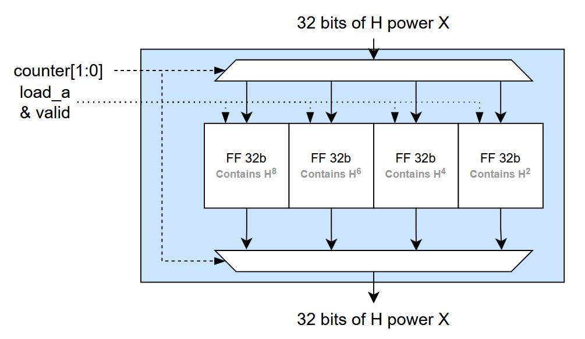
this is a simple bank of registers selected by a counter, that can be loaded using the "valid" signal coming out of the h_init module producing powers of H.

This valid signal has to be mixed with a "load" signal, since h_init never stops, it emits periodically new powers of H indefinitely.

Moreover, the output of h_init goes to both columns A and B on the right side and left side, but only one column actually needs the output during the initialization phase.

left side needs even powers of H, this is when load_a will be triggered, and right side needs odd powers of H, this is when load_b will be triggered.

**in the end** : 
- left-hand column contains H\^8, H\^6, H\^4, and H²
- right-hand column contains H\^7, H\^5, H\^3, and H
- the power of H is selected by a 2 bits counter : 
	- counter = 3 selects H\^8 in the left-hand column (A) and H\^7 in the right-hand column (B)
	- counter = 2 selects H\^6 and H\^5
	- and so on...
- Both columns contains 4 rows of registers :
	- the first rows contain bits 31 to 0 of their respective powers of H
	- the second rows contain bits 63 to 32
	- and so on...
so each row can provide the 32 bits part of H power X needed to compute some C(i) x H power(X)

# control logic and timing

*Click the image to open the full-resolution SVG.*

As we have seen, during the computation of powers of H and their registration in the columns of registers, the counter is uniform.

But as 2 blocks are entering the GHASH each clock cycles, we have to pipeline the counter, and the valid signals, so they follow their respective block down the columns without being affected by the corresponding other counter and valid_signals of the new inputs.

We can see counter_delay_reg(0 to 2) and valid_delay_reg(0 to 2) registers following their respective block along the 4 rows of computational units, so these multH_32 units can select, at the right row, the right power of H for the right block.

To give an example to better understand the logic :
- at clock cycle 1, C2|C3 enters the first rows of processing columns
	- counter = 2, so bits 31 to 0 of H\^6 and H\^5 are selected on first multH_32 
- at clock cycle 2, C4|C5 enters the first rows of processing columns
	- counter = 1, so bits 31 to 0 of H\^4 and H\^3 are selected on first multH_32 
- AND C2|C3 enters the second rows of processing columns 
	- counter_delay_reg(0) = 2, so bits 63 to 32 of H\^6 and H\^5 are selected on second multH_32 
- and so on...

## about control

Everything is controled by two signals (two other ones reserved for special cases) :
- the counter, telling us which cycle of a batch we are processing
	- when we are processing the pair of blocks of cycle 0, the counter is at 3
		- it selects H\^8 and H\^7
	- when we are processing the pair of blocks of cycle 0, the counter is at 2
		- it selects H\^6 and H\^5
	- ...
	- when we are processing the pair of blocks of cycle 0, the counter is at 0
		- it selects H² and H
		- AND it flushes the output accumulator to begin the calculation of the next batch (Y(i) = C(i-8) + Y(i-8)xH\^8 + ...)
- valid_a and valid_b tells us that the pair of blocks is valid and can enter the ghash_engine
	- when at a cycle, valid signals are low, 0 is sent on the processing columns, so it won't pollute the result accumulator (result XOR "0...0" = result)
# special cases : the uncomplete final batch
We defined batches as groups of 8 blocks which depend on only one previous tag to compute the next one.

what if the last group isn't complete ?
## even case

Lets imagine, for example, C0 to C11 :
- C0 to C7 constitute the first batch, it is complete
- C8 to C11 do not complete the final batch, there's only 4 blocks out of 8 expected

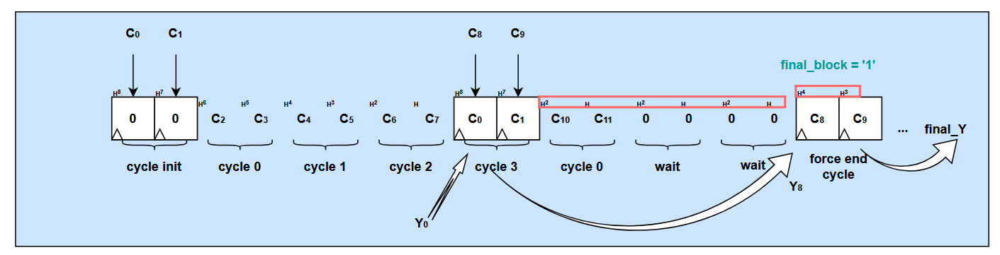

The calculation of the last batch changes : 
final_Y = ( C(8) + Y(8) ) x H\^4

\+ C(9) x H\^3

\+ C(10) x H²

\+ C(11) x H

We need only H to H\^4 this time to do the calculation. 

And we need to wait for Y8 to be available, hence a few wait cycles

But we need a special signal final_block : 
- the last blocks to be processed (saved in the registers) C8 and C9 need "counter =1" to be associated with H\^4 and H\^3
- but the counter value announcing the end of a batch is "counter = 3" on a normal case
	- we therefore need "final_block" signal to replace "counter=3" final signal
	- This signal just allows the blocks saved in the register to go through the processing columns

# odd case

Same case as even case, with only one special particularity

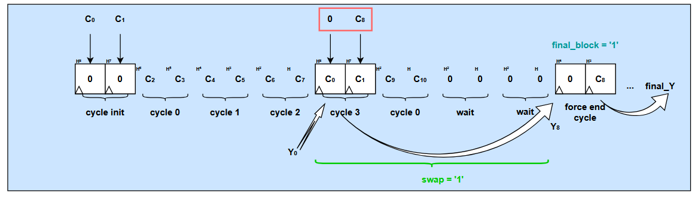

The calculation becomes : 

final_Y = ( C(8) + Y(8) ) x H\^3

\+ C(9) x H²

\+ C(10) x H

This time, C(8) isn't associated with an even power of H, but an odd one.

The odd powers of H are on the right-hand column :
- we need to swap inputs so the right-hand ones go on the left side, and vice versa
- Hence the input signal "swap"
	- the swapping of the signal is done outside the GHASH block, but it still needs to know inputs have been swapped, so this time, the right side register XORs its output with the previous tag - and vice versa, the left one do not have to XOR it with the previous tag

# GIF to show the ghash in action

